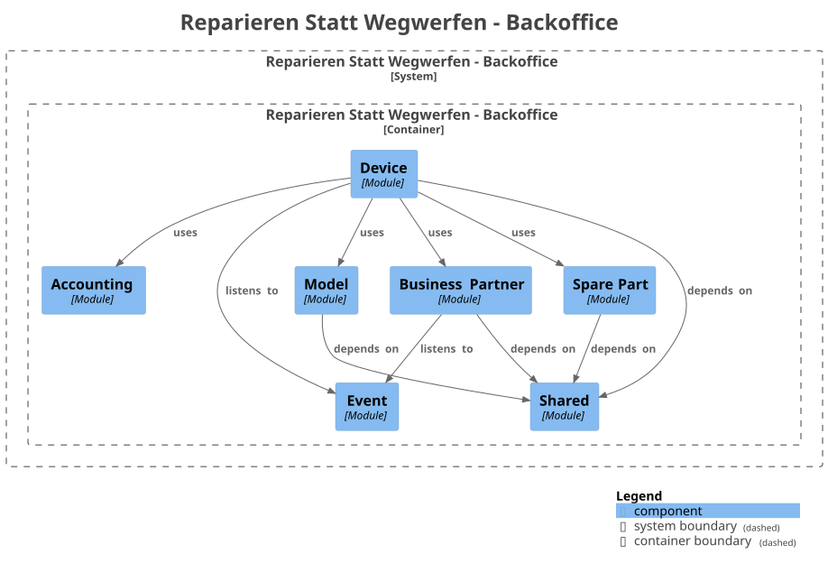

[](
https://github.com/fafeichter/ReparierenStattWegwerfen-BackOffice/actions/workflows/qodana_code_quality.yml)
[](
https://github.com/fafeichter/ReparierenStattWegwerfen-BackOffice/actions/workflows/ci-cd.yml)

# Reparieren Statt Wegwerfen - Backoffice

This is the back-office application for my company,
[Reparieren Statt Wegwerfen](https://reparieren-statt-wegwerfen.at/), used to manage and track
my repair and refurbishment workflow. It replaces my legacy Apple Numbers-based solution,
which had reached the limits of its capabilities.

I decided to open-source this project to enforce better security practices, such as keeping
secrets out of the repository.

---

## Development Approach

Since I need this fast, I follow this approach: _Make it exist first, make it better later._

---

## 🏗️ Architecture & Design

The application is built adhering to modern architectural practices to ensure maintainability,
scalability, and clean boundaries:

- **Modular Monolith (Modulith):** Promotes a highly structured monolithic architecture with
  strictly enforced package boundaries, combining the simplicity of a single deployment with the
  decoupled nature of microservices.
- **Domain-Driven Design (DDD):** Core business logic is modeled after my real-world
  refurbishment and repair workflows.

The following domains have been identified:

| Domain               | Module Name       | Description                                                                                                                                                                  |
|:---------------------|:------------------|:-----------------------------------------------------------------------------------------------------------------------------------------------------------------------------|
| **Device**           | `device`          | Tracks the entire lifecycle of a specific MacBook or iPad within the company — from initial acquisition through repair stages to resale, or its disassembly for spare parts. |
| **Business Partner** | `businesspartner` | A person or a company I buy from or sell devices and/or spare parts to..                                                                                                     |
| **Model**            | `model`           | Defines all models I repair or refurbish: MacBooks and iPads with Apple Silicon.                                                                                             |
| **Spare Part**       | `sparepart`       | Manages spare parts required for device repair and refurbishment, sourced from business partners or harvested from disassembled devices.                                     |
| **Accounting**       | `accounting`      | Keeps track of balances, taxes, and invoices.                                                                                                                                |



---

## 📌 Roadmap

| Milestone | Name                  | Target            |
|-----------|-----------------------|-------------------|
| 1         | Excel Ablöse          | Autumn 2026       |
| 2         | Make Backoffice Great | Q4 2026 / Q1 2027 |
| 3         | Accounting Domain     | 2027              |
| 4         | Spare Parts Domain    | 2027              |

### Milestone 1 – "Excel Ablöse"

**Target:** Autumn 2026

Replace the existing Apple Numbers spreadsheet with a modern web application built on Domain-Driven Design (DDD) principles.

### Milestone 2 – "Make Backoffice Great"

**Target:** Q4 2026 / Q1 2027

Improve the application based on experience from daily use, with a focus on UI/UX.

### Milestone 3 – "Accounting Domain"

**Target:** 2027

Implement the Accounting domain.

### Milestone 4 – "Spare Parts Domain"

**Target:** 2027

Implement the Spare Parts domain.

---

### Backlog (not yet scheduled)

- **Real-Time Updates:** Push changes to the client via WebSockets (or a similar technology) instead of reloading the data.

---

> **Note:** Every milestone includes ongoing work to keep the codebase healthy and stable, and strict adherence to DDD principles.

## 🛠️ Tech Stack

- **Backend:** Java / Spring Boot
- **Frontend:** Angular + Clarity Design System
- **Database:** MySQL
- **Identity & Access Management:** Keycloak

---

## 👨‍💻️ Development Setup

To run the application, install Docker and execute the preconfigured Angular and Spring Boot run configurations
within IntelliJ IDEA.

### Environment Configuration

Create a `secrets.env` file in the root directory and provide the required secrets:

```.env
OPENAI_API_KEY_DEV=<your_api_key>
GEMINI_API_KEY_DEV=<your_api_key>
```

### Optional Dependencies

Generating the project module diagram shown above requires `Graphviz`. You can install it using Homebrew and
this projects `Brewfile`:

```bash
brew bundle
```

---

## 📄 License

This project is licensed under the terms of the open-source license included in the repository.
See the `LICENSE` file for details.